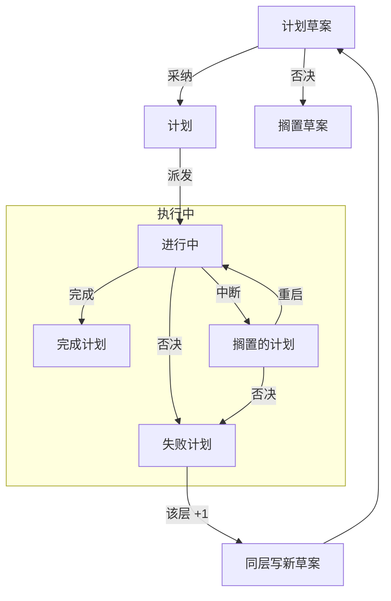

## B系列-设计（B-03）· 计划的状态机

- 主要目标
  - 状态是**计划**的属性，不是执行节点的属性。A 系列也一样有这些状态。
  - 草案在执行之外；采纳仍不算执行；**派发才进入"执行中"**。
  - 一个计划只派发一次：派出去就是一条分支，分支的生命就是这份计划的生命。否决了就写下一份，不重派同一份。

- 扳机与事件

| 扳机（谁做了什么） | 事件 | 状态变成 |
|---|---|---|
| 父写草案 | `op:'plan'` | 草案 |
| 用户采纳 | `op:'adopt'` | 计划 |
| 用户否决草案 | `op:'reject-draft'` | 搁置草案（不计数） |
| 父派发 | `op:'dispatch'`（带 `planId`） | 进行中 |
| 子报完成 | `op:'file'` success | 完成计划 |
| 子报否决 | `op:'file'` reject | 失败计划（该层 +1） |
| 子报中断 | `op:'file'` shelved | 搁置的计划 |
| 否决搁置中的 | `op:'status'` fail | 失败计划（该层 +1） |
| 重启搁置中的 | `op:'status'` resume | 进行中 |
| 任何状态变化 | 宿主往父与同层兄弟各 append 一条 `user/message` | —（只是通知） |

- 计数的边界
  - **草案被否决不计数**：那是用户改主意，丢进"搁置草案"留档，不占权重。
  - **只有从"进行中"或"搁置的计划"走到"失败计划"才 +1**——那意味着真的派出去过、并且执行失败。
  - 搁置、要信息、未采纳都不动计数。同层共用一个数，到 3 就锁这一层，只接受研究任务。
- 采纳之后发生什么
  - 采纳只做两件事：状态改成"计划"，再给父与同层兄弟各发一条一句话通知（计划 id + 标题 + 文件路径）。
  - **采纳 ≠ 派发**：采纳是用户的判断，派发是父的时机。派发是另一步，带工作区、带派发理由。
  - 并行采纳就是连着改几次状态、发几条通知；合取是父在同一批里派多个，不是一种特殊状态。
- 时刻同步父与兄弟
  - 子会话的投影是分叉时冻结的，看不到分叉之后兄弟发生的事，所以必须由**宿主拼消息**进去。
  - 做法：状态一变，宿主对父与每个仍在运行的兄弟会话 `append` 一条 `user/message`，正文一句话（谁的什么状态变了），`source.kind` 用专用的（如 `plan-state`）；细节让各自调 `plan_tree`。
  - 合法性：`user/message` 是唯一不吃 `turn` / `step` 约束的面事件，任何时刻追加都不破坏日志；`system/message` 只能在打开的步骤里写，异步写必炸。
  - 正在跑的会话下一个步骤就读到；空闲的醒来也读到——两种情况都不需要唤醒。
- 约束/许可/缺点
  - 状态只能由两类扳机改：用户（采纳、否决、搁置、回答）与执行者结算（完成、否决、中断）。父不能替用户采纳。
  - "中断"只有一种：代价过大、要更多信息、要研究，都是同一条边，落到"搁置的计划"，不在状态上分家。
  - 缺点：草案、计划、节点三者的状态需要分别显示，渲染时要说清"这是计划态还是节点态"。
  - 缺点：状态广播是逐条消息，采纳三份就是三条；不做批量合并。
- 工具
  - 计划记录加 `status`（草案 / 计划 / 进行中 / 完成 / 失败 / 搁置 / 搁置草案），取代 `adopted: boolean`。
  - 执行节点保留 open / success / reject / shelved，与计划态是多对一。
  - 派发记录必须带 `planId`，否则节点不知道自己属于哪份计划。
  - 上面九种扳机各是一条 `op`，同一个 `plugin:plan-tree/node` 类型，不新增事件类型。
- 实现状态
  - **还没落地**：现在没有 `status` 字段，七态是从 `adopted` / `rejected` / `shelved` 与派发节点推出来的（退化成三个布尔 + 一个推导函数），结果与这张表一致，但流转型事件（`status:fail` / `status:resume`）没有实现，`file` 也只改节点不改计划。
  - 已落地的是：`op:'dispatch'` 带 `planId`、九种扳机的 `op` 命名、以及"草案被否决不计数"这条边界。
